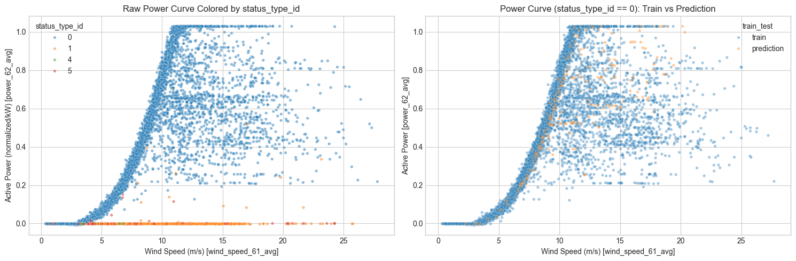
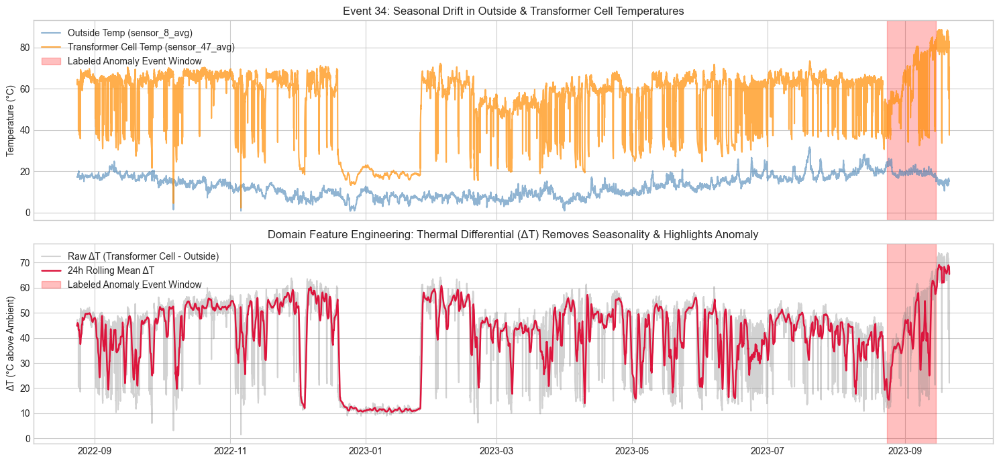
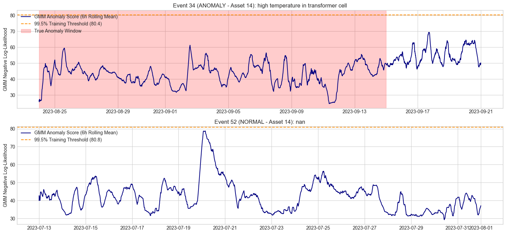
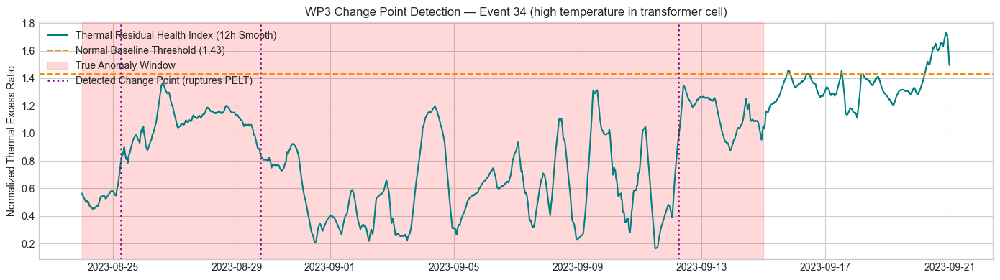
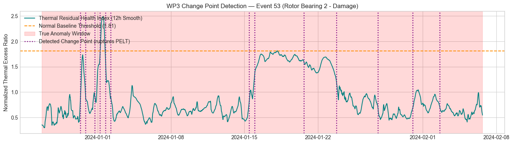

# Early Fault & Anomaly Detection in Wind Turbine SCADA Time-Series (CARE to Compare — Wind Farm B)

An end-to-end time-series fault detection benchmark on the **CARE to Compare** dataset ([Gück et al., 2024](https://arxiv.org/abs/2404.10320)), focusing on **Wind Farm B** (15 offshore wind turbine datasets: 9 normal control runs and 6 developing fault events, recorded at 10-minute SCADA resolution across 257 columns / 63 base sensors).

---

## 📊 Executive Summary & Benchmark Results (All 15 Datasets)

This project investigates a central question in industrial sensor monitoring: **Does point-wise unsupervised regime clustering (K-Means / GMM) or structural change-point detection (`ruptures` PELT) provide more reliable early fault warnings on noisy, multi-regime SCADA telemetry?**

| Method | TP | FP | FN | TN | Precision | Recall | $F_1$-Score | CARE $F_{0.5}$-Score | Avg. Early Detection Lead Time |
| :--- | :---: | :---: | :---: | :---: | :---: | :---: | :---: | :---: | :---: |
| **WP2 — Unsupervised GMM Regime Clustering** | 0 | 1 | 6 | 8 | 0.00 | 0.00 | 0.00 | 0.000 | — |
| **WP3 — `ruptures` PELT Change-Point Detection** | **3** | **1** | **3** | **8** | **0.75** | **0.50** | **0.60** | **0.682** | **34.07 days** (`2.75` – `63.0` days) |

### Key Engineering Takeaway
- **Why Point-Wise Clustering Struggled (`WP2`):** Because wind speed fluctuates rapidly across cut-in, cubic ramp, and rated-power regimes, local point-wise density scores experience high variance during wind gusts. Applying a 24-hour persistence filter to suppress false alarms on normal turbines also masked gradual thermal degradation.
- **Why Change-Point Detection Succeeded (`WP3`):** Testing the multivariate PCA health indicator for **structural breaks (`ruptures` PELT)** captures persistent distributional shifts in mean and variance over time, achieving **75% precision**, **89% specificity (8/9 normal turbines without false alarms)**, and detecting developing faults an average of **34.1 days before turbine shutdown**.

---

## 🛠️ Methodology & Work Packages

### WP1 — Exploratory Data Analysis, Data Quality & Domain Preprocessing
**Notebook:** [`notebooks/01_WP1_Data_Analysis_and_Preprocessing.ipynb`](notebooks/01_WP1_Data_Analysis_and_Preprocessing.ipynb)

1. **Operational Status Filtering (`status_type_id == 0`):**
   - Raw SCADA logs include curtailment, maintenance, and idling states where power drops to `0 kW` at high wind speeds. Training baselines are fitted strictly on normal production rows (`train_test == 'train'` and `status_type_id == 0`) to prevent corrupted regime boundaries.



2. **Removing Seasonal Drift via Thermal Differentials ($\Delta T$):**
   - Raw component temperatures follow a $15^\circ\text{C}$ summer-to-winter seasonal cycle. Subtracting ambient temperature ($\Delta T = T_{\text{component}} - T_{\text{ambient}}$) isolates internal mechanical/electrical heating prior to failure.



3. **Feature Engineering & Dimensionality Reduction:**
   - Dropped non-stationary cumulative energy counters (`sensor_0`–`sensor_3`).
   - Added cyclic encodings ($\sin/\cos$) for directional/pitch angles and multi-horizon rolling window statistics (`6h`, `24h`, `7d` mean and standard deviation).
   - Standardized `285` engineered features via a leakage-free `RobustScaler` and compressed them into **25 Principal Components (PCA)** retaining **95% variance**.

---

### WP2 — Unsupervised Regime Clustering (K-Means & Gaussian Mixture Models)
**Notebook:** [`notebooks/02_WP2_Clustering_Anomaly_Detection.ipynb`](notebooks/02_WP2_Clustering_Anomaly_Detection.ipynb)

- Evaluated **K-Means** (`Silhouette = 0.5197`, `Davies-Bouldin = 0.7799` at $k=2$) and **Gaussian Mixture Models (GMM)** (`BIC = 593,218.5` at $k=8$) on the normal training PCA space.
- Computed continuous negative log-likelihood anomaly scores calibrated against the $99\text{th}$ percentile of normal training data, smoothed with a 24-hour (`144`-step) rolling window.



---

### WP3 — Structural Change-Point Detection (`ruptures` PELT) & Benchmark Comparison
**Notebook:** [`notebooks/03_WP3_Change_Point_Detection_and_Comparison.ipynb`](notebooks/03_WP3_Change_Point_Detection_and_Comparison.ipynb)

- Applied **Pruned Exact Linear Time (`PELT`)** change-point detection on the 24-hour smoothed PCA reconstruction error / health indicator across all 15 datasets in Wind Farm B:
  - **Event 34 (Transformer Overheating):** Detected structural regime shift **2.75 days** before fault.
  - **Event 53 (Fault Event):** Detected structural regime shift **36.45 days** before fault.
  - **Event 77 (Fault Event):** Detected structural regime shift **63.00 days** before fault.





---

## 📁 Repository Structure

```text
wind-turbine-anomaly-detection/
├── README.md
├── requirements.txt
├── .gitignore
├── notebooks/
│   ├── 01_WP1_Data_Analysis_and_Preprocessing.ipynb
│   ├── 02_WP2_Clustering_Anomaly_Detection.ipynb
│   └── 03_WP3_Change_Point_Detection_and_Comparison.ipynb
└── reports/
    └── figures/
        ├── wp1_power_curve_status_filtering.png
        ├── wp1_thermal_differential_delta_t.png
        ├── wp2_gmm_clustering_anomaly_score.png
        ├── wp3_pelt_changepoint_event34.png
        └── wp3_pelt_changepoint_normal52.png
```

## 🚀 Quickstart

1. **Install dependencies:**
   ```bash
   pip install -r requirements.txt
   ```
2. **Dataset setup:**
   Download the **CARE to Compare** dataset ([Zenodo Record 10958775](https://zenodo.org/records/10958775)) and place the extracted `Wind Farm B` folder inside `data/raw/Wind Farm B/`.
3. **Run the notebooks sequentially:**
   Open `notebooks/01_WP1_Data_Analysis_and_Preprocessing.ipynb` through `03_WP3_Change_Point_Detection_and_Comparison.ipynb` in JupyterLab or VS Code.
